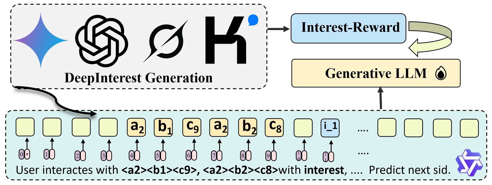

# DeepInterestGR

## Pipeline



## Quick Start(need api-key)

```bash
# Run the DeepInterestGR pipeline
python Gen_DeepInterest.py
```

## Comparison with MiniOneRec

| Feature | MiniOneRec | DeepInterestGR |
|---------|------------|----------------|
| **Interest Mining** | Surface-level textual features | Multi-LLM deep interest mining (MLIM) |
| **Interest Quality Control** | None | Reward-Labeled Deep Interest (RLDI) |
| **Item Discretization** | Text-only SID encoding | Interest-Enhanced Item Discretization (IEID) |
| **Reward Strategy** | Rule-based/Collaborative | Interest-Aware Reward |
| **Training Pipeline** | SFT only | SFT + RL (GRPO) |
| **HR@10 Improvement** | Baseline | +9.2%--12.1% |
| **NDCG@10 Improvement** | Baseline | +11.2%--13.9% |
| **Cross-Domain Generalization** | Baseline | +24.8% HR@10 |
| **Multi-Modal Support** | Text-only | Multi-modal LLM variants |
